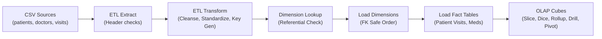

# DM Lab Experiment 1: Healthcare Data Warehouse

[](https://github.com/VSK-777/DM-Lab-Experiment-1)
[](https://www.python.org/)
[](https://www.mysql.com/)
[-brightgreen.svg)](tests/)
[](docs/EXPERIMENT.md)

End-to-end, reproducible implementation of **Data Mining Laboratory Experiment 1: Creation of a Data Warehouse** based on university syllabus specification `Exp-1.pdf`.

Demonstrates healthcare multidimensional modeling, automated ETL data engineering pipelines, foreign-key safe warehouse loading, and all five core OLAP analytical operations (Slice, Dice, Roll-up, Drill-down, and Pivot).

---

## Table of Contents
1. [Experiment Aim & Objectives](#experiment-aim--objectives)
2. [Key Features](#key-features)
3. [Architecture Overview](#architecture-overview)
4. [Multidimensional Schemas](#multidimensional-schemas)
5. [Project Directory Layout](#project-directory-layout)
6. [Prerequisites & Environment](#prerequisites--environment)
7. [Quickstart Guide](#quickstart-guide)
8. [Database Initialization & DDL](#database-initialization--ddl)
9. [ETL Pipeline Execution](#etl-pipeline-execution)
10. [OLAP Analytical Operations](#olap-analytical-operations)
11. [Automated Test Suite & Validation](#automated-test-suite--validation)
12. [Pentaho Data Integration (PDI) Integration](#pentaho-data-integration-pdi-integration)
13. [University Lab Documentation](#university-lab-documentation)
14. [Troubleshooting & FAQs](#troubleshooting--faqs)
15. [Limitations & Notes](#limitations--notes)

---

## 1. Experiment Aim & Objectives

As mandated by university laboratory manual `Exp-1.pdf`:
1. **Build a Data Warehouse / Data Mart** using relational database engines (MySQL 9.5 / SQLite 3) and data warehouse ETL tools (Python ETL / Pentaho Data Integration).
2. **Design Multi-Dimensional Data Models:**
   - **Star Schema** centered on `Fact_Patient_Visit`.
   - **Snowflake Schema** normalizing hospital locations into 3NF.
   - **Fact Constellation (Galaxy) Schema** sharing conformed dimensions across visits and medication records.
3. **Write and Implement ETL Scripts** to extract, cleanse, standardize (e.g. M/F $\rightarrow$ Male/Female, date conversions), and load dimensional data.
4. **Execute all Five OLAP Operations:**
   - **Slice:** Show all patient visits in 2024.
   - **Dice:** Patients from Mumbai treated by Cardiologists in 2024.
   - **Roll-Up:** Aggregate daily/monthly visits to quarterly summaries.
   - **Drill-Down:** Decompose quarterly statistics into monthly/daily encounters.
   - **Pivot:** Cross-tabulate doctors as rows and hospitals as columns.

---

## 2. Key Features

- **Dual-Engine Flexibility:** Native support for MySQL 8.x/9.x production environments alongside zero-setup SQLite 3 portable mode.
- **Reproducible Synthetic Datasets:** Seeded random generator producing 25 patients, 10 doctors, 5 hospitals, 8 medications, 70 patient visits, and 35 prescriptions.
- **Defensive ETL Engineering:** Automatic gender mapping, multi-format date parsing (`YYYY-MM-DD` and `DD-MM-YYYY`), positive value validation, surrogate key generation, and duplicate handling.
- **Idempotent Data Loads:** Transaction-safe loading order that guarantees identical results on repeated runs without duplicate keys.
- **100% Automated Test Coverage:** Pytest suite testing transformation rules, relational foreign keys, quarterly reconciliation invariants, and query outputs.
- **Full Academic Lab Record:** Ready-to-submit university lab report (`docs/EXPERIMENT.md`), viva preparation guide (`docs/VIVA_QUESTIONS.md`), and sample outputs.

---

## 3. Architecture Overview



---

## 4. Multidimensional Schemas

### 4.1 Star Schema
- **Fact Table:** `Fact_Patient_Visit` (Measures: `Treatment_Cost`, `Visit_Duration_Minutes`)
- **Dimensions:** `Dim_Patient`, `Dim_Doctor`, `Dim_Hospital`, `Dim_Date`

### 4.2 Snowflake Schema
- Normalizes `Dim_Hospital` into `Dim_Hospital_Snowflake` referencing `Dim_Location` (City, State, Country, Region).

### 4.3 Fact Constellation Schema
- Multiple fact tables sharing conformed dimensions:
  - `Fact_Patient_Visit` (Outpatient encounters)
  - `Fact_Medication_Records` (Prescription dispensations)
  - **Shared Dimensions:** `Dim_Patient`, `Dim_Doctor`, `Dim_Date`
  - **Specific Dimension:** `Dim_Medication`

*Full schema diagrams and data dictionaries are available in [docs/SCHEMAS.md](docs/SCHEMAS.md).*

---

## 5. Project Directory Layout

```
DM-Lab-Experiment-1/
├── README.md                           # Master project guide
├── PROGRESS.md                         # Milestone tracking and commit log
├── .gitignore                          # Protects credentials, venvs, and temp files
├── requirements.txt                    # Python package dependencies
├── .env.example                        # Template for database configuration
├── Exp-1.pdf                           # Official university lab specification
├── docs/
│   ├── REQUIREMENTS.md                 # Requirements traceability matrix
│   ├── EXPERIMENT.md                   # Complete 16-section college lab record
│   ├── ARCHITECTURE.md                 # End-to-end architecture & Mermaid diagrams
│   ├── SCHEMAS.md                      # Detailed Star, Snowflake, and Constellation specs
│   ├── ETL_WORKFLOW.md                 # Transformation logic & Pentaho mapping
│   ├── OLAP_EXPLANATION.md             # In-depth OLAP concepts and interpretation
│   ├── VIVA_QUESTIONS.md               # 25 university viva examination Q&As
│   └── TROUBLESHOOTING.md              # Common errors and resolutions
├── data/
│   ├── patients.csv                    # Synthetic patient demographic data
│   ├── doctors.csv                     # Medical specialists and experience
│   ├── hospitals.csv                   # Healthcare facilities and locations
│   ├── patient_visits.csv              # Outpatient clinical visit logs
│   ├── medications.csv                 # Pharmaceutical drugs catalog
│   └── medication_records.csv          # Dispensed prescription records
├── sql/
│   ├── 01_create_database.sql          # Database initialization
│   ├── 02_star_schema.sql              # Star Schema DDL
│   ├── 03_snowflake_schema.sql         # Snowflake Schema DDL
│   ├── 04_fact_constellation_schema.sql# Fact Constellation DDL
│   ├── 05_load_sample_data.sql         # Standalone SQL INSERT statements
│   ├── 06_olap_operations.sql          # Slice, Dice, Roll-up, Drill-down, Pivot queries
│   ├── 07_validation_queries.sql       # Relational invariant and reconciliation checks
│   └── 08_cleanup.sql                  # Safe teardown script
├── etl/
│   ├── __init__.py                     # Package marker
│   ├── extract.py                      # CSV ingestion and validation
│   ├── transform.py                    # Cleansing, standardization, and surrogate keys
│   ├── load.py                         # MySQL/SQLite foreign-key safe loader
│   ├── run_etl.py                      # Master ETL pipeline runner
│   ├── run_olap.py                     # Executes OLAP queries & generates reports
│   ├── generate_data.py                # Reproducible synthetic dataset generator
│   ├── generate_sql_inserts.py         # Converts CSV data into 05_load_sample_data.sql
│   └── README.md                       # ETL technical overview
├── tests/
│   ├── test_transform.py               # Unit tests for cleansing and transformations
│   └── test_warehouse.py               # Integration & warehouse invariant tests
├── reports/
│   ├── sample_outputs.md               # Actual outputs captured from OLAP queries
│   └── experiment_results.md           # Analytical report and summary of findings
└── pentaho/
    ├── README.md                       # PDI Spoon step-by-step setup guide
    └── healthcare_etl_transform.ktr    # Genuine Pentaho XML transformation artifact
```

---

## 6. Prerequisites & Environment

1. **Python:** Version 3.10 or higher.
2. **Database Engine:** MySQL Server 8.0+ or 9.x (or built-in SQLite 3).
3. **Optional ETL Tool:** Pentaho Data Integration (PDI / Kettle) 9.x or 11.0.

Install Python dependencies:
```powershell
pip install -r requirements.txt
```

---

## 7. Quickstart Guide

Run the complete pipeline end-to-end with two commands:

```powershell
# 1. Run the ETL pipeline (loads MySQL or SQLite based on .env)
python etl/run_etl.py

# 2. Run all OLAP queries and output results
python etl/run_olap.py

# 3. Run the automated test suite
pytest tests/ -v
```

---

## 8. Database Configuration

Copy the example environment configuration:
```powershell
Copy-Item .env.example .env
```

Edit `.env` to match your local database settings:
```ini
# Choose 'mysql' or 'sqlite'
DB_ENGINE=mysql

# MySQL Connection Details
DB_HOST=localhost
DB_PORT=3306
DB_NAME=healthcare_dw
DB_USER=root
DB_PASSWORD=your_password_here

# SQLite Path (for portable execution)
SQLITE_DB_PATH=healthcare_dw.db
```

---

## 9. OLAP Analytical Operations

All queries are defined in [`sql/06_olap_operations.sql`](sql/06_olap_operations.sql).

### 9.1 Slice Query (Page 7)
Filters to a single time slice (`Year = 2024`):
```sql
SELECT f.Visit_ID, p.Name AS Patient_Name, d.Specialization, h.Hospital_Name, dt.Date, f.Treatment_Cost
FROM Fact_Patient_Visit f
JOIN Dim_Patient p ON f.Patient_ID = p.Patient_ID
JOIN Dim_Doctor d ON f.Doctor_ID = d.Doctor_ID
JOIN Dim_Hospital h ON f.Hospital_ID = h.Hospital_ID
JOIN Dim_Date dt ON f.Date_ID = dt.Date_ID
WHERE dt.Year = 2024;
```

### 9.2 Dice Query (Page 7)
Filters on multiple dimensions (`City = 'Mumbai'`, `Specialization = 'Cardiology'`, `Year = 2024`):
```sql
SELECT f.Visit_ID, p.Name AS Patient_Name, p.City, d.Name AS Doctor_Name, d.Specialization, dt.Date, f.Treatment_Cost
FROM Fact_Patient_Visit f
JOIN Dim_Patient p ON f.Patient_ID = p.Patient_ID
JOIN Dim_Doctor d ON f.Doctor_ID = d.Doctor_ID
JOIN Dim_Hospital h ON f.Hospital_ID = h.Hospital_ID
JOIN Dim_Date dt ON f.Date_ID = dt.Date_ID
WHERE p.City = 'Mumbai'
  AND d.Specialization = 'Cardiology'
  AND dt.Year = 2024;
```

### 9.3 Roll-Up Query (Page 7)
Aggregates visits by Quarter:
```sql
SELECT dt.Year, dt.Quarter,
       COUNT(f.Visit_ID) AS Total_Visits,
       SUM(f.Treatment_Cost) AS Total_Cost,
       ROUND(AVG(f.Treatment_Cost), 2) AS Avg_Cost
FROM Fact_Patient_Visit f
JOIN Dim_Date dt ON f.Date_ID = dt.Date_ID
WHERE dt.Year = 2024
GROUP BY dt.Year, dt.Quarter
ORDER BY dt.Quarter;
```

### 9.4 Drill-Down Query (Page 7)
Drills from Quarter down to individual Months:
```sql
SELECT dt.Quarter, dt.Month,
       COUNT(f.Visit_ID) AS Monthly_Visits,
       SUM(f.Treatment_Cost) AS Monthly_Cost
FROM Fact_Patient_Visit f
JOIN Dim_Date dt ON f.Date_ID = dt.Date_ID
WHERE dt.Year = 2024
GROUP BY dt.Quarter, dt.Month
ORDER BY dt.Quarter, dt.Month;
```

### 9.5 Pivot Query (Page 7)
Doctors as rows, Hospitals as columns cross-tabulation:
```sql
SELECT 
    d.Name AS Doctor_Name, d.Specialization,
    SUM(CASE WHEN h.Hospital_Name = 'Apollo Hospitals' THEN 1 ELSE 0 END) AS Apollo,
    SUM(CASE WHEN h.Hospital_Name = 'Fortis Hospital' THEN 1 ELSE 0 END) AS Fortis,
    SUM(CASE WHEN h.Hospital_Name = 'Manipal Hospital' THEN 1 ELSE 0 END) AS Manipal,
    SUM(CASE WHEN h.Hospital_Name = 'Max Healthcare' THEN 1 ELSE 0 END) AS Max_Health,
    SUM(CASE WHEN h.Hospital_Name = 'AIIMS' THEN 1 ELSE 0 END) AS AIIMS,
    COUNT(f.Visit_ID) AS Total_Visits
FROM Dim_Doctor d
LEFT JOIN Fact_Patient_Visit f ON d.Doctor_ID = f.Doctor_ID
LEFT JOIN Dim_Hospital h ON f.Hospital_ID = h.Hospital_ID
GROUP BY d.Doctor_ID, d.Name, d.Specialization;
```

*Actual execution outputs and tables are recorded in [reports/sample_outputs.md](reports/sample_outputs.md).*

---

## 10. Automated Test Suite

Run all unit tests and warehouse invariant checks:
```powershell
pytest tests/ -v
```

### Verified Test Results:
```
tests/test_transform.py::TestTransformationRules::test_standardize_gender_valid PASSED
tests/test_transform.py::TestTransformationRules::test_standardize_gender_invalid PASSED
tests/test_transform.py::TestTransformationRules::test_parse_date_attributes_iso PASSED
tests/test_transform.py::TestTransformationRules::test_parse_date_attributes_dmy PASSED
tests/test_transform.py::TestTransformationRules::test_parse_date_attributes_invalid PASSED
tests/test_transform.py::TestTransformationRules::test_clean_string PASSED
tests/test_transform.py::TestTransformationRules::test_parse_positive_float PASSED
tests/test_transform.py::TestTransformationRules::test_parse_positive_int PASSED
tests/test_transform.py::TestWarehouseTransformer::test_patient_transformation_and_deduplication PASSED
tests/test_transform.py::TestWarehouseTransformer::test_visit_referential_integrity_rejection PASSED
tests/test_warehouse.py::TestWarehouseInvariants::test_referential_integrity_foreign_keys PASSED
tests/test_warehouse.py::TestWarehouseInvariants::test_fact_row_count_integrity PASSED
tests/test_warehouse.py::TestWarehouseInvariants::test_reconciliation_quarterly_totals_match_yearly PASSED
tests/test_warehouse.py::TestWarehouseInvariants::test_dice_query_filters_all_specified_dimensions PASSED
tests/test_warehouse.py::TestWarehouseInvariants::test_pivot_matrix_marginal_sums_reconcile PASSED
tests/test_warehouse.py::TestWarehouseInvariants::test_etl_idempotency_rerun PASSED

============================== 16 passed in 0.44s ==============================
```

---

## 11. University Lab Documentation

- [docs/EXPERIMENT.md](docs/EXPERIMENT.md): Full university lab record covering Aim, Tools, Theory, Schemas, Table Structures, Procedure, SQL, OLAP, and Conclusion.
- [docs/VIVA_QUESTIONS.md](docs/VIVA_QUESTIONS.md): 25 comprehensive viva questions with detailed answers.
- [docs/SCHEMAS.md](docs/SCHEMAS.md): Multidimensional data models and Mermaid diagrams.
- [docs/ARCHITECTURE.md](docs/ARCHITECTURE.md): Pipeline architecture and data flow.
- [docs/ETL_WORKFLOW.md](docs/ETL_WORKFLOW.md): Cleansing rules and PDI step mapping.
- [docs/TROUBLESHOOTING.md](docs/TROUBLESHOOTING.md): Problem diagnosis and recovery guide.

---

## 12. References

1. University Lab Manual: `Exp-1.pdf` — *Experiment 1: Creation of a Data Warehouse*.
2. J. Han, M. Kamber, J. Pei: *Data Mining: Concepts and Techniques*, 3rd Edition, Morgan Kaufmann.
3. Ralph Kimball, Margy Ross: *The Data Warehouse Toolkit: The Definitive Guide to Dimensional Modeling*, 3rd Edition, Wiley.
