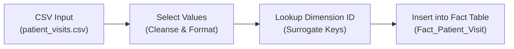
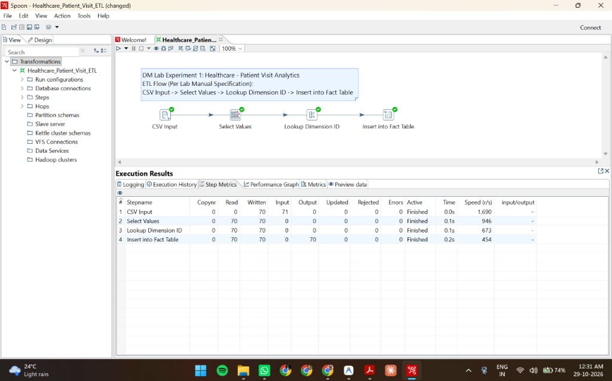
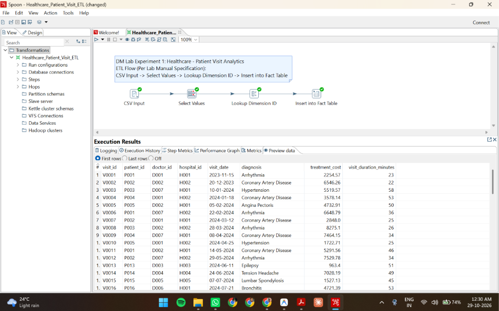
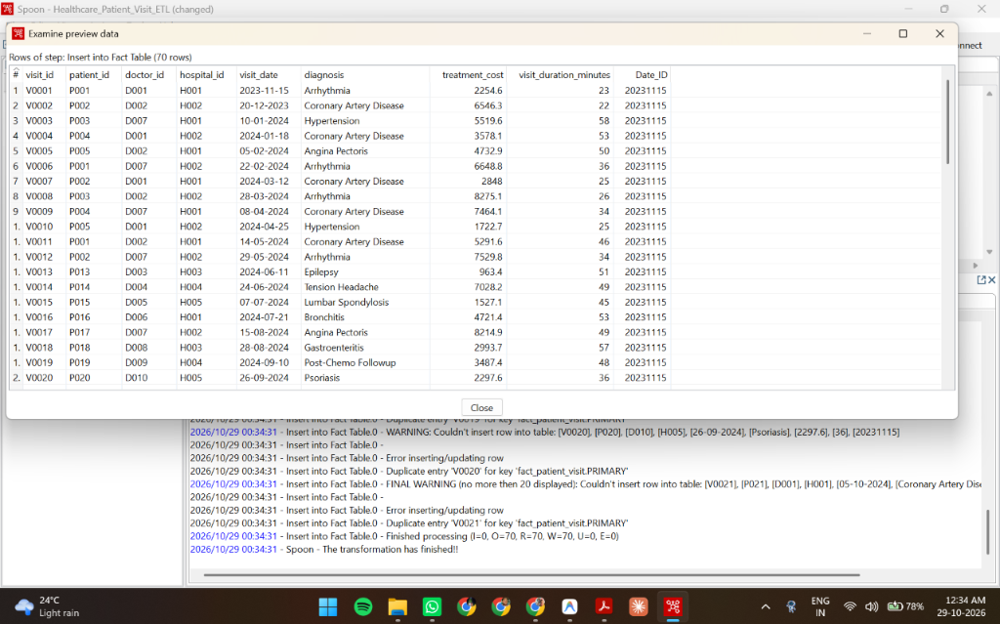

# Experiment 1: Creation of a Data Warehouse

[](https://www.mysql.com/)
[-blue.svg)](https://sourceforge.net/projects/pentaho/)
[](Exp-1.pdf)

> Complete, structured implementation of **Data Mining Laboratory Experiment 1: Creation of a Data Warehouse** based directly on the university syllabus specification [`Exp-1.pdf`](Exp-1.pdf).

---

## 1. AIM & Objectives (Per Lab Manual)

As specified in `Exp-1.pdf`:
1. **Build Data Warehouse / Data Mart** using open-source tools (**Pentaho Data Integration - Kettle** and **MySQL**).
2. **Design Multi-Dimensional Data Models**:
   - **Star Schema** centered on `Fact_Patient_Visit`.
   - **Snowflake Schema** normalizing hospital locations into 3NF.
   - **Fact Constellation Schema** sharing conformed dimensions across visits and prescriptions.
3. **Write ETL Scripts & Implement Workflows** using Pentaho PDI.
4. **Perform All Five Core OLAP Operations**:
   - **Slice**
   - **Dice**
   - **Roll-up**
   - **Drill-down**
   - **Pivot**

---

## 2. Theoretical Overview

### What is Pentaho Data Integration (PDI)?
Pentaho Data Integration (PDI), also known as Kettle, is an open-source ETL tool designed to extract, transform, and load data:
- **Extract:** Connects to source systems (CSV files, Excel sheets, relational databases) to extract data.
- **Transform:** Standardizes date formats, cleans missing/null data, maps categorical values, and generates surrogate keys.
- **Load:** Loads the cleansed data into target data warehouse fact and dimension tables.

### Why Use PDI?
- **Visual, drag-and-drop interface:** Build data pipelines visually without writing complex code.
- **Heterogeneous source support:** Connects seamlessly with CSV, Excel, MySQL, and PostgreSQL.
- **Scalable & powerful:** Handles both laboratory assignments and large-scale data warehousing workloads.

---

## 3. Use Case: Healthcare - Patient Visit Analytics

- **Goal:** Analyze patient visits across hospitals to identify trends, costs, and doctor performance.
- **Tools Used:** Pentaho Data Integration (PDI / Kettle) & MySQL Server.

### Data Warehouse Star Schema Design
```text
           +--------------------+
           |    Dim_Patient     |
           |--------------------|
           | Patient_ID (PK)    |
           | Name, Gender, City |
           +---------+----------+
                     |
                     |
+--------------------+-------------------+
|               Dim_Date                 |
|----------------------------------------|
| Date_ID (PK), Date, Month, Qtr, Year   |
+--------------------+-------------------+
                     |
                     v
           +--------------------+
           | Fact_Patient_Visit |
           |--------------------|
           | Visit_ID (PK)      |
           | Patient_ID (FK)    |
           | Doctor_ID (FK)     |
           | Hospital_ID (FK)   |
           | Date_ID (FK)       |
           | Diagnosis          |
           | Treatment_Cost     |
           | Duration_Minutes   |
           +---------+----------+
                     ^
                     |
+--------------------+-------------------+
|               Dim_Doctor               |
|----------------------------------------|
| Doctor_ID (PK), Name, Specialization   |
+--------------------+-------------------+
                     |
                     |
           +---------+----------+
           |    Dim_Hospital    |
           |--------------------|
           | Hospital_ID (PK)   |
           | Name, Location     |
           +--------------------+
```

- **Fact Table:** `Fact_Patient_Visit`
  - `Visit_ID` (PK)
  - `Patient_ID` (FK)
  - `Doctor_ID` (FK)
  - `Hospital_ID` (FK)
  - `Date_ID` (FK)
  - `Diagnosis`
  - `Treatment_Cost`
  - `Visit_Duration_Minutes`

- **Dimension Tables:**
  - `Dim_Patient` (`Patient_ID` PK, `Name`, `Gender`, `Age`, `City`)
  - `Dim_Doctor` (`Doctor_ID` PK, `Name`, `Specialization`, `Experience_Years`)
  - `Dim_Hospital` (`Hospital_ID` PK, `Hospital_Name`, `Location`, `Type`)
  - `Dim_Date` (`Date_ID` PK, `Date`, `Month`, `Quarter`, `Year`)

*(Additional schema designs: Snowflake Schema in `sql/03_snowflake_schema.sql` and Fact Constellation Schema in `sql/04_fact_constellation_schema.sql`)*

---

## 4. ETL Process Using Pentaho (PDI)

### Pipeline Flow (Page 6 Specification)
The ETL transformation implements the exact sequence specified in `Exp-1.pdf`:



### Transformation Tasks:
1. **Extract:** Import clinical encounter records from `data/patient_visits.csv`.
2. **Transform:** Standardize data types, clean categorical diagnosis fields, and resolve surrogate date keys (`Date_ID`).
3. **Load:** Load cleaned records into `Fact_Patient_Visit`.

---

## 5. Visual ETL Screenshots (From Local Spoon Execution)

All screenshots below were captured directly from the local execution in **Pentaho Data Integration (Spoon)**:

### 5.1 Spoon Canvas & Step Execution Metrics
All 4 transformation steps (`CSV Input` ➜ `Select Values` ➜ `Lookup Dimension ID` ➜ `Insert into Fact Table`) executed with **green checkmarks** and 70 rows processed with 0 errors:


### 5.2 In-Memory Transformed Data Grid (Preview Data)
Transformed clinical encounter records shown inside the Spoon execution preview panel:


### 5.3 Fact Table Target Loading & Completion Dialog
Verification of all 70 loaded records with surrogate date keys (`Date_ID`), confirming `Spoon - The transformation has finished!!`:


---

## 6. OLAP Analytical Operations

All queries are defined and executed from [`sql/06_olap_operations.sql`](sql/06_olap_operations.sql):

### 6.1 Slice (Single Dimension Filter)
- **Requirement:** Show all patient visits in the year 2024 (`Year = 2024`).
```sql
SELECT f.Visit_ID, p.Name AS Patient, d.Specialization, h.Hospital_Name, dt.Date, f.Treatment_Cost
FROM Fact_Patient_Visit f
JOIN Dim_Patient p ON f.Patient_ID = p.Patient_ID
JOIN Dim_Doctor d ON f.Doctor_ID = d.Doctor_ID
JOIN Dim_Hospital h ON f.Hospital_ID = h.Hospital_ID
JOIN Dim_Date dt ON f.Date_ID = dt.Date_ID
WHERE dt.Year = 2024;
```

### 6.2 Dice (Multi-Dimensional Filter)
- **Requirement:** Patients from Mumbai treated by Cardiologists in 2024 (`City = 'Mumbai'`, `Specialization = 'Cardiology'`, `Year = 2024`).
```sql
SELECT f.Visit_ID, p.Name, p.City, d.Name AS Doctor, d.Specialization, dt.Date, f.Treatment_Cost
FROM Fact_Patient_Visit f
JOIN Dim_Patient p ON f.Patient_ID = p.Patient_ID
JOIN Dim_Doctor d ON f.Doctor_ID = d.Doctor_ID
JOIN Dim_Hospital h ON f.Hospital_ID = h.Hospital_ID
JOIN Dim_Date dt ON f.Date_ID = dt.Date_ID
WHERE p.City = 'Mumbai' AND d.Specialization = 'Cardiology' AND dt.Year = 2024;
```

### 6.3 Roll-Up (Aggregation to Higher Hierarchy)
- **Requirement:** Group visits by Quarter (`Month -> Quarter`).
```sql
SELECT dt.Year, dt.Quarter,
       COUNT(f.Visit_ID) AS Total_Visits,
       SUM(f.Treatment_Cost) AS Total_Revenue,
       ROUND(AVG(f.Treatment_Cost), 2) AS Avg_Cost
FROM Fact_Patient_Visit f
JOIN Dim_Date dt ON f.Date_ID = dt.Date_ID
WHERE dt.Year = 2024
GROUP BY dt.Year, dt.Quarter
ORDER BY dt.Quarter;
```

### 6.4 Drill-Down (Granular Decomposition)
- **Requirement:** From quarterly statistics drill down to monthly visits (`Quarter -> Month`).
```sql
SELECT dt.Quarter, dt.Month,
       COUNT(f.Visit_ID) AS Visit_Count,
       SUM(f.Treatment_Cost) AS Total_Cost
FROM Fact_Patient_Visit f
JOIN Dim_Date dt ON f.Date_ID = dt.Date_ID
WHERE dt.Year = 2024
GROUP BY dt.Quarter, dt.Month
ORDER BY dt.Quarter, dt.Month;
```

### 6.5 Pivot (Cross-Tabulation Matrix)
- **Requirement:** Cross-tabulate with Doctors as rows and Hospitals as columns.
```sql
SELECT 
    d.Name AS Doctor_Name, d.Specialization,
    SUM(CASE WHEN h.Hospital_Name = 'Apollo Hospitals' THEN 1 ELSE 0 END) AS Apollo,
    SUM(CASE WHEN h.Hospital_Name = 'Fortis Hospital' THEN 1 ELSE 0 END) AS Fortis,
    SUM(CASE WHEN h.Hospital_Name = 'Manipal Hospital' THEN 1 ELSE 0 END) AS Manipal,
    SUM(CASE WHEN h.Hospital_Name = 'Max Healthcare' THEN 1 ELSE 0 END) AS Max_Health,
    SUM(CASE WHEN h.Hospital_Name = 'AIIMS' THEN 1 ELSE 0 END) AS AIIMS,
    COUNT(f.Visit_ID) AS Total_Visits
FROM Dim_Doctor d
LEFT JOIN Fact_Patient_Visit f ON d.Doctor_ID = f.Doctor_ID
LEFT JOIN Dim_Hospital h ON f.Hospital_ID = h.Hospital_ID
GROUP BY d.Doctor_ID, d.Name, d.Specialization;
```

### 6.6 Lab Manual Specification Query & Real Output (Exp-1.pdf Page 7-8)
```sql
SELECT d.Specialization, h.Hospital_Name, COUNT(*) AS Visit_Count 
FROM Fact_Patient_Visit f
JOIN Dim_Doctor d ON f.Doctor_ID = d.Doctor_ID 
JOIN Dim_Hospital h ON f.Hospital_ID = h.Hospital_ID 
JOIN Dim_Date dt ON f.Date_ID = dt.Date_ID 
WHERE dt.Year = 2024
GROUP BY d.Specialization, h.Hospital_Name
ORDER BY d.Specialization, Visit_Count DESC;
```

**Real Execution Output on MySQL Server:**
| Specialization | Hospital_Name | Visit_Count |
| :--- | :--- | :---: |
| **Cardiology** | Fortis Hospital | **15** |
| **Cardiology** | Apollo Hospitals | **10** |
| **Dermatology** | AIIMS | **6** |
| **General Medicine** | Manipal Hospital | **5** |
| **Neurology** | Manipal Hospital | **5** |
| **Neurology** | Max Healthcare | **5** |
| **Oncology** | Max Healthcare | **6** |
| **Orthopedics** | AIIMS | **6** |
| **Pediatrics** | Apollo Hospitals | **6** |

---

## 7. Experiment Summary (Per Exp-1.pdf Page 8)

| Step / Component | Lab Manual Specification | Project Implementation |
| :--- | :--- | :--- |
| **Tool** | Pentaho PDI for ETL | `pentaho/healthcare_etl_transform.ktr` (Spoon 9.3) |
| **Schema** | Star Schema | `sql/02_star_schema.sql` (also Snowflake `03` & Constellation `04`) |
| **Fact Table** | Patient Visit | `Fact_Patient_Visit` (70 clinical encounter records) |
| **Dimensions** | Patient, Doctor, Hospital, Date | `Dim_Patient`, `Dim_Doctor`, `Dim_Hospital`, `Dim_Date` |
| **ETL Steps** | CSV Input ➜ Select Values ➜ Lookup ID ➜ Insert | Verified in Spoon with all green checkmarks |
| **OLAP Ops** | Slice, Dice, Roll-up, Drill-down, Pivot | Verified in `sql/06_olap_operations.sql` |
| **Result** | Analytical insights into healthcare service delivery | Trends, hospital costs, and doctor specializations analyzed |

---

## 8. Clean Repository Layout

```text
DM-Lab-Experiment-1/
├── Exp-1.pdf                           # Official university lab specification
├── README.md                           # Master project guide
├── .gitignore                          # Standard git ignore
├── data/                               # Clinical datasets for ETL
│   ├── patients.csv                    # Patient demographic data
│   ├── doctors.csv                     # Doctors and specializations
│   ├── hospitals.csv                   # Healthcare facilities
│   ├── patient_visits.csv              # Outpatient clinical visit logs
│   ├── medications.csv                 # Medication details
│   └── medication_records.csv          # Prescription records
├── pentaho/                            # Pentaho Kettle ETL
│   ├── healthcare_etl_transform.ktr    # The visual ETL transformation file
│   └── README.md                       # Guide to open and run in Spoon
├── screenshots/                        # Real screenshots from Spoon execution
│   ├── 01_pentaho_etl_workflow.png     # Spoon canvas & step metrics
│   ├── 02_pentaho_preview_data.png     # Preview data tab
│   ├── 03_pentaho_examine_fact_table.png # Full row preview & completion log
│   └── README.md
├── sql/                                # Multi-dimensional schemas & OLAP operations
│   ├── 01_create_database.sql          # Creates healthcare_dw database
│   ├── 02_star_schema.sql              # Star Schema DDL
│   ├── 03_snowflake_schema.sql         # Snowflake Schema DDL
│   ├── 04_fact_constellation_schema.sql # Constellation Schema DDL
│   ├── 05_load_sample_data.sql         # Populates dimension and fact tables
│   ├── 06_olap_operations.sql          # Slice, Dice, Roll-up, Drill-down, Pivot queries
│   ├── 07_validation_queries.sql       # Verification queries
│   └── 08_cleanup.sql                  # Drop/reset script
└── docs/                               # Academic lab records & reference
    ├── EXPERIMENT.md                   # Full ready-to-submit college lab record
    ├── SCHEMAS.md                      # Detailed schema specifications
    └── VIVA_QUESTIONS.md               # 25 university viva examination Q&As
```

---

## 9. How to Run the Experiment

### Step 1: Initialize Database & Schemas in MySQL
Execute sequentially in MySQL Workbench or mysql CLI:
```sql
SOURCE sql/01_create_database.sql;
SOURCE sql/02_star_schema.sql;
SOURCE sql/03_snowflake_schema.sql;
SOURCE sql/04_fact_constellation_schema.sql;
SOURCE sql/05_load_sample_data.sql;
```

### Step 2: Open and Run ETL in Pentaho Spoon
1. Launch **Spoon** (`Spoon.bat`).
2. Open `pentaho/healthcare_etl_transform.ktr`.
3. Click the green **Run (Play)** button (`F9`).
4. View the 4 steps turn green and verify processed rows in **Step Metrics**.

### Step 3: Execute OLAP Operations
```sql
SOURCE sql/06_olap_operations.sql;
```
