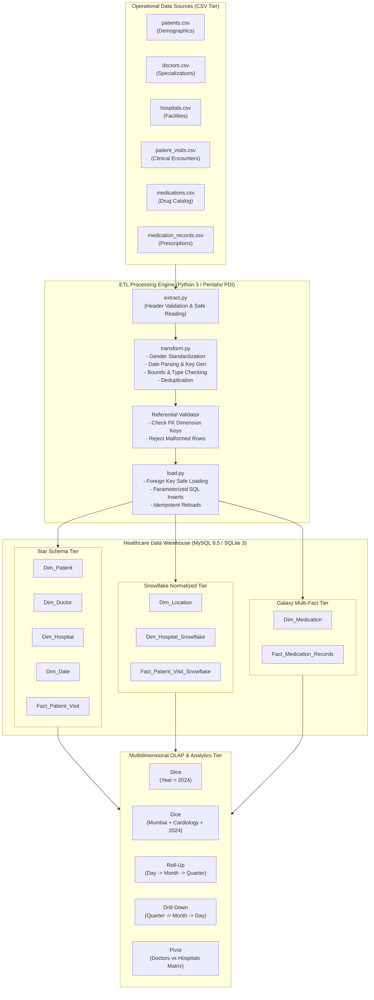

# Data Warehouse End-to-End Architecture

This document outlines the architectural data flow, component layout, and structural relationships of the **Healthcare Data Warehouse** implemented for DM Lab Experiment 1.

---

## 1. End-to-End Data Pipeline Architecture

---

## 2. Component Descriptions

### 2.1 Extraction Tier
- Reads raw files using defensive character-encoding handlers (`utf-8-sig`).
- Validates that mandatory column headers exist before processing row records.
- Flags corrupted or unreadable CSV files without halting execution prematurely.

### 2.2 Transformation Tier
- **Gender Standardization:** Converts heterogeneous user entries (`M`, `m`, `Male `, `F`, `f`, `Female `) into canonical relational values `Male` or `Female`.
- **Date Dimension Resolution:** Converts dates (`DD-MM-YYYY`, `YYYY-MM-DD`) into a unified calendar record and generates a deterministic integer key (`Date_ID = YYYYMMDD`).
- **Data Quality Invariants:** Verifies that ages, monetary costs, and consultation durations are positive non-null quantities.
- **Dimension Key Resolution:** Ensures every foreign key in fact rows maps to a valid record in the corresponding dimension table before loading.

### 2.3 Loading Tier
- Implements **two-phase foreign key safe loading**:
  1. Primary dimensions (`Dim_Patient`, `Dim_Doctor`, `Dim_Hospital`, `Dim_Location`, `Dim_Date`, `Dim_Medication`) are loaded first.
  2. Fact tables (`Fact_Patient_Visit`, `Fact_Patient_Visit_Snowflake`, `Fact_Medication_Records`) are loaded subsequently.
- Employs **idempotency**: Clears tables in reverse-dependency order before re-loading so repeated executions never duplicate rows.

### 2.4 Analytical OLAP Tier
- Executes slice, dice, roll-up, drill-down, and cross-tabulation pivot queries.
- Demonstrates how business analysts and hospital administrators extract operational insights (e.g., quarterly expenditures, regional doctor allocation, and cross-hospital patient load).
