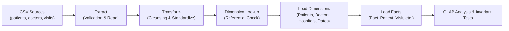

# Healthcare Warehouse ETL Workflow Documentation

This document describes the operational workflow of the ETL pipeline, detailing data cleansing, validation rules, transformation stages, and execution mapping to Pentaho Data Integration (PDI / Kettle).

---

## 1. ETL Workflow Stage Diagram

---

## 2. Transformation Rules & Logic

| Source Field | Transformation Rule | Output Value | Rejection Criteria |
|:---|:---|:---|:---|
| `patients.gender` | String trim + uppercase match: `M`, `MALE` $\rightarrow$ `Male`; `F`, `FEMALE` $\rightarrow$ `Female` | `'Male'` or `'Female'` | Non-matching gender string (logged to `rejected_records`) |
| `patients.age` | Positive integer parsing ($0 \le \text{age} \le 130$) | Integer (e.g. `34`) | Negative numbers, strings, or age $> 130$ |
| `patient_visits.visit_date` | Multi-format date parsing (`YYYY-MM-DD`, `DD-MM-YYYY`) | String `'YYYY-MM-DD'` + Integer `Date_ID` (`YYYYMMDD`) | Unparseable date strings |
| `patient_visits.treatment_cost` | Float parsing rounded to 2 decimal places | Decimal (e.g. `3500.50`) | Negative numbers or non-numeric strings |
| `patient_visits.visit_duration_minutes` | Strictly positive integer ($> 0$) | Integer (e.g. `45`) | Zero, negative numbers, or non-numeric strings |
| `patient_visits.patient_id` | Foreign Key Lookup against `Dim_Patient` | Validated `Patient_ID` | Key not found in extracted dimension set |
| `patient_visits.doctor_id` | Foreign Key Lookup against `Dim_Doctor` | Validated `Doctor_ID` | Key not found in extracted dimension set |
| `patient_visits.hospital_id` | Foreign Key Lookup against `Dim_Hospital` | Validated `Hospital_ID` | Key not found in extracted dimension set |

---

## 3. Dimension Key Resolution & Date Dimension Generation

In dimensional modeling, dates are represented by a conformed calendar dimension (`Dim_Date`) with a smart integer surrogate key:
$$\text{Date\_ID} = \text{Year} \times 10000 + \text{Month} \times 100 + \text{Day}$$

*Example:* `18-01-2024` $\rightarrow$ `Date_ID = 20240118`, `Month = 1`, `Quarter = 'Q1'`, `Year = 2024`.

Generating the calendar dimension dynamically during visit transformation guarantees that every date referenced in `Fact_Patient_Visit` is pre-populated in `Dim_Date` before the fact rows are loaded into the database, preserving referential integrity.

---

## 4. Mapping Python ETL Steps to Pentaho Data Integration (PDI)

The Python ETL scripts correspond directly to standard PDI (Spoon) transformation steps:

| ETL Function | Python 3 Module | Equivalent Pentaho PDI (Kettle) Step |
|:---|:---|:---|
| CSV Ingestion | `etl/extract.py:extract_csv()` | **CSV file input** step |
| Header Validation | `etl/extract.py:EXPECTED_SCHEMAS` | **Select values** (Metadata tab) |
| Gender Standardization | `etl/transform.py:standardize_gender()` | **Value mapper** or **Modified JavaScript value** |
| Date Parsing & Smart Key | `etl/transform.py:parse_date_attributes()` | **Calculator** or **Formula** step |
| Referential Key Lookup | `etl/transform.py:transform_visits()` | **Database lookup** / **Dimension lookup/update** |
| Rejection & Error Logging | `HealthcareWarehouseTransformer.rejected_records` | **Error handling** hop to **Text file output** |
| Dimension Loading | `etl/load.py:load_warehouse_tables()` | **Table output** (Dimensions target tables) |
| Fact Loading | `etl/load.py:load_warehouse_tables()` | **Table output** (Fact target tables) |

---

## 5. Idempotent Loading Strategy

To ensure that the ETL pipeline can be executed repeatedly without generating duplicate primary key errors or duplicate fact rows:
1. When `load_warehouse_tables()` is called, it issues `DELETE FROM` statements in reverse foreign-key dependency order (`Fact` tables first, followed by `Dimension` tables).
2. The entire load process is wrapped in a transactional block. If any insert fails, the transaction is rolled back, preventing partial or corrupt states.
3. Dimension tables are populated before any dependent fact tables are inserted.
