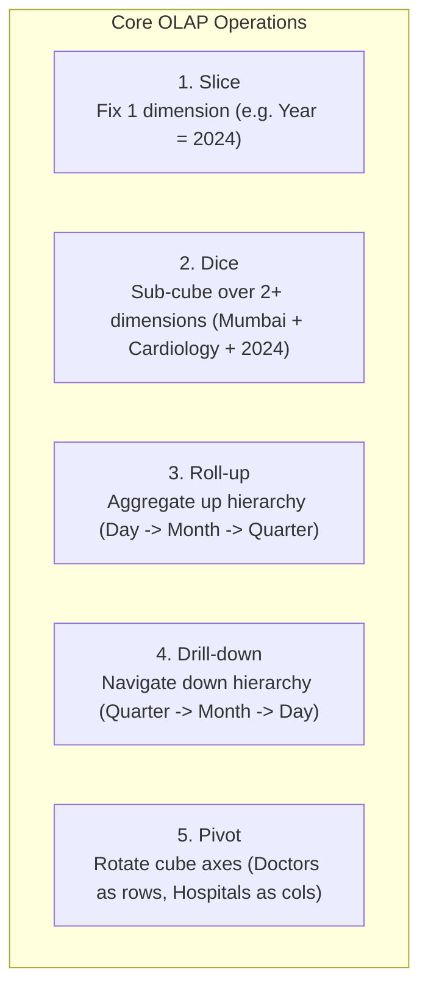

# Multidimensional OLAP Operations Explained

This document provides a conceptual, mathematical, and practical explanation of the five core OLAP operations implemented in the Healthcare Data Warehouse, accompanied by actual execution outputs.

---

## 1. Overview of OLAP Cubes

An **OLAP Cube** is a multidimensional data array structured by orthogonal dimensions (e.g., Doctor, Patient, Hospital, Time) containing quantifiable measures (e.g., Treatment Cost, Visit Duration).

Unlike traditional relational operational databases (OLTP) designed for transaction throughput (OLTP normalized into 3NF), OLAP multidimensional databases are optimized for rapid aggregation, slicing, and ad-hoc analytical inquiry.

---

## 2. The Five Core OLAP Operations



---

## 3. Detailed Operations & Actual Execution

### 3.1 SLICE
- **Concept:** Performs a selection on a single dimension of a given cube, resulting in a sub-cube of lower dimensionality (a 2D rectangular slice from a 3D cube).
- **Manual Requirement:** Show all patient visits for the year 2024.
- **SQL Implementation:**
  ```sql
  SELECT f.Visit_ID, p.Name AS Patient, d.Specialization, h.Hospital_Name, dt.Date, f.Treatment_Cost
  FROM Fact_Patient_Visit f
  JOIN Dim_Patient p ON f.Patient_ID = p.Patient_ID
  JOIN Dim_Doctor d ON f.Doctor_ID = d.Doctor_ID
  JOIN Dim_Hospital h ON f.Hospital_ID = h.Hospital_ID
  JOIN Dim_Date dt ON f.Date_ID = dt.Date_ID
  WHERE dt.Year = 2024;
  ```
- **Interpretation:** Eliminates all non-2024 visits (such as 2023 historical records), focusing the analytical lens exclusively on the 2024 operating year (yielding 64 patient encounters).

---

### 3.2 DICE
- **Concept:** Defines a sub-cube by selecting two or more dimensions simultaneously using boolean conditional predicates.
- **Manual Requirement:** Patients from Mumbai treated by Cardiologists in 2024.
- **SQL Implementation:**
  ```sql
  SELECT f.Visit_ID, p.Name AS Patient, p.City, d.Name AS Doctor, d.Specialization, dt.Date, f.Treatment_Cost
  FROM Fact_Patient_Visit f
  JOIN Dim_Patient p ON f.Patient_ID = p.Patient_ID
  JOIN Dim_Doctor d ON f.Doctor_ID = d.Doctor_ID
  JOIN Dim_Hospital h ON f.Hospital_ID = h.Hospital_ID
  JOIN Dim_Date dt ON f.Date_ID = dt.Date_ID
  WHERE p.City = 'Mumbai'
    AND d.Specialization = 'Cardiology'
    AND dt.Year = 2024;
  ```
- **Interpretation:** Extracted 15 matching records. This shows how hospital management can analyze high-risk cardiac patient segments originating from specific metropolitan clusters.

---

### 3.3 ROLL-UP
- **Concept:** Performs aggregation on a data cube either by climbing up a concept hierarchy for a dimension or by dimension reduction (e.g. Day $\rightarrow$ Month $\rightarrow$ Quarter $\rightarrow$ Year).
- **Manual Requirement:** Group visits by Quarter, aggregating visit count and treatment cost.
- **SQL Implementation:**
  ```sql
  SELECT dt.Year, dt.Quarter,
         COUNT(f.Visit_ID) AS Total_Visits,
         SUM(f.Treatment_Cost) AS Total_Treatment_Cost,
         ROUND(AVG(f.Treatment_Cost), 2) AS Avg_Treatment_Cost
  FROM Fact_Patient_Visit f
  JOIN Dim_Date dt ON f.Date_ID = dt.Date_ID
  WHERE dt.Year = 2024
  GROUP BY dt.Year, dt.Quarter
  ORDER BY dt.Quarter;
  ```
- **Actual Execution Output:**
  | Quarter | Total Visits | Total Treatment Cost (₹) | Avg Treatment Cost (₹) |
  |:---|:---|:---|:---|
  | Q1 | 18 | 91,692.13 | 5,094.01 |
  | Q2 | 18 | 86,867.27 | 4,825.96 |
  | Q3 | 16 | 62,456.75 | 3,903.55 |
  | Q4 | 12 | 44,969.92 | 3,747.49 |

---

### 3.4 DRILL-DOWN
- **Concept:** The reverse of roll-up. Navigates from less detailed (summarized) data to more detailed data by stepping down a concept hierarchy or introducing additional dimensions.
- **Manual Requirement:** From quarterly stats $\rightarrow$ drill down to monthly visits.
- **SQL Implementation (Child Level):**
  ```sql
  SELECT dt.Quarter, dt.Month,
         COUNT(f.Visit_ID) AS Monthly_Visits,
         SUM(f.Treatment_Cost) AS Monthly_Cost
  FROM Fact_Patient_Visit f
  JOIN Dim_Date dt ON f.Date_ID = dt.Date_ID
  WHERE dt.Year = 2024
  GROUP BY dt.Quarter, dt.Month
  ORDER BY dt.Quarter, dt.Month;
  ```
- **Interpretation:** Decomposes Q1's 18 visits into Month 1 (6 visits, ₹33,581.31), Month 2 (6 visits, ₹29,833.09), and Month 3 (6 visits, ₹28,277.73), revealing seasonal trends within the quarter.

---

### 3.5 PIVOT (CROSS-TABULATION)
- **Concept:** A visualization operation that rotates data axes in order to provide an alternative presentation of multidimensional data.
- **Manual Requirement:** Pivot table with Doctors as rows and Hospitals as columns.
- **SQL Implementation (Conditional Aggregation):**
  ```sql
  SELECT 
      d.Name AS Doctor_Name,
      d.Specialization,
      SUM(CASE WHEN h.Hospital_Name = 'Apollo Hospitals' THEN 1 ELSE 0 END) AS Apollo,
      SUM(CASE WHEN h.Hospital_Name = 'Fortis Hospital' THEN 1 ELSE 0 END) AS Fortis,
      SUM(CASE WHEN h.Hospital_Name = 'Manipal Hospital' THEN 1 ELSE 0 END) AS Manipal,
      SUM(CASE WHEN h.Hospital_Name = 'Max Healthcare' THEN 1 ELSE 0 END) AS Max_Health,
      SUM(CASE WHEN h.Hospital_Name = 'AIIMS' THEN 1 ELSE 0 END) AS AIIMS,
      COUNT(f.Visit_ID) AS Total_Visits
  FROM Dim_Doctor d
  LEFT JOIN Fact_Patient_Visit f ON d.Doctor_ID = f.Doctor_ID
  LEFT JOIN Dim_Hospital h ON f.Hospital_ID = h.Hospital_ID
  GROUP BY d.Doctor_ID, d.Name, d.Specialization
  ORDER BY d.Specialization, d.Name;
  ```
- **Interpretation:** Creates an executive matrix showing clinical distribution across healthcare branches, enabling resource optimization and physician cross-scheduling.
