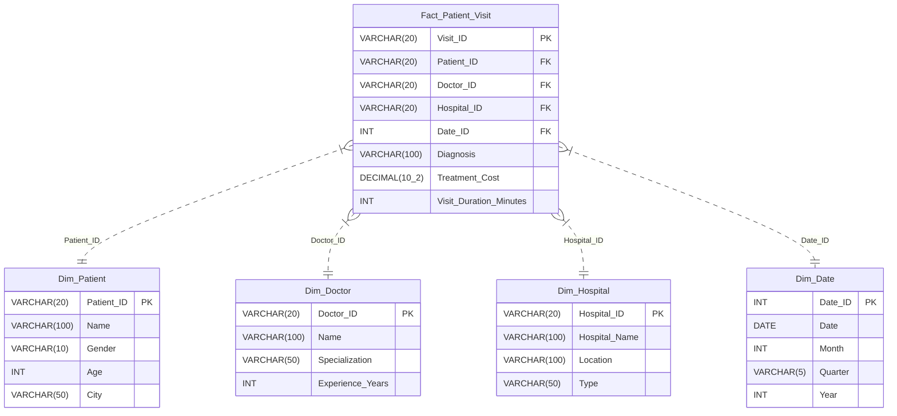
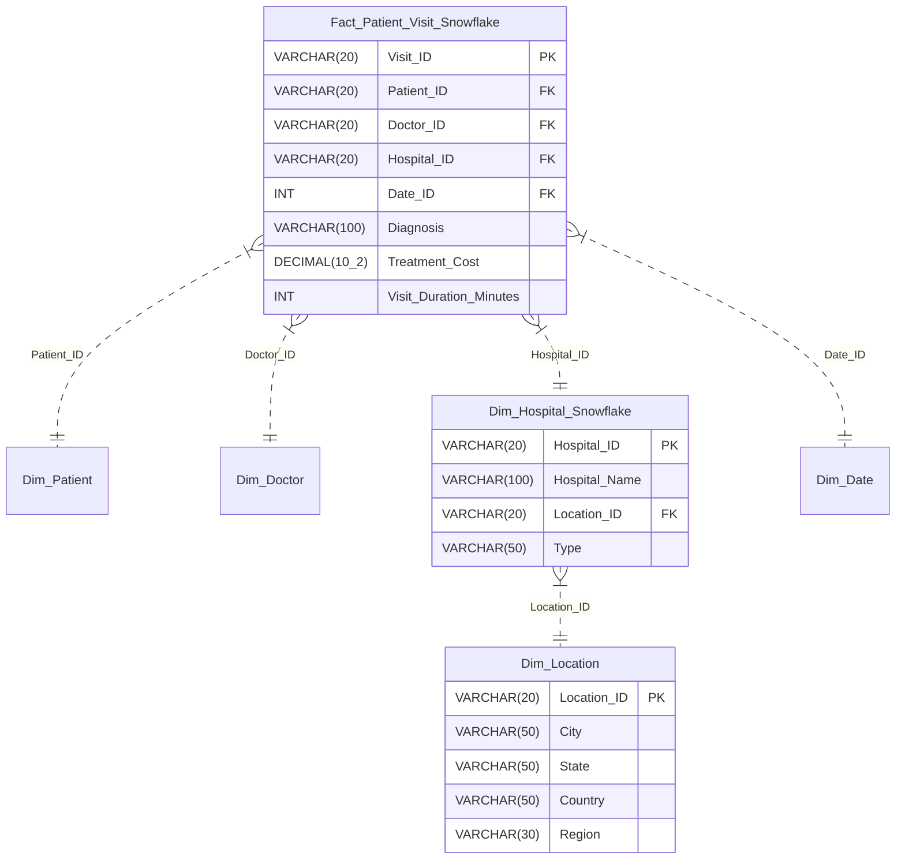
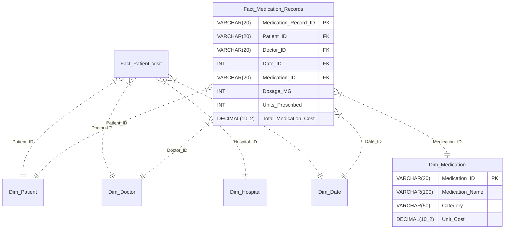

# Multidimensional Warehouse Schemas

This document provides formal data dictionary specifications and Mermaid architectural diagrams for the three dimensional schemas implemented in the Healthcare Data Warehouse:
1. **Star Schema** (Central baseline required by university lab manual)
2. **Snowflake Schema** (3NF normalization of location hierarchy)
3. **Fact Constellation Schema** (Galaxy schema with multiple fact tables sharing conformed dimensions)

---

## 1. Star Schema Architecture

The Star Schema models outpatient clinical encounters centered on the `Fact_Patient_Visit` table surrounded by four de-normalized dimension tables.

### Mermaid Diagram: Star Schema

### Fact Table Grain
- **Grain:** Exactly one physical doctor-patient clinical encounter (outpatient visit).
- **Measures (Facts):**
  - `Treatment_Cost`: Fully additive monetary measure in INR.
  - `Visit_Duration_Minutes`: Additive temporal duration measure in minutes.
- **Degenerate / Context Dimensions:**
  - `Diagnosis`: Categorical clinical determination recorded per visit.

---

## 2. Snowflake Schema Architecture

In the Snowflake Schema, the `Dim_Hospital` dimension is normalized into 3NF by extracting geographic hierarchies into an outrigger dimension table: `Dim_Location`.

### Mermaid Diagram: Snowflake Schema

### Normalization Trade-Off Analysis
- **Advantage:** Eliminates city and state data redundancy across multiple hospitals situated in the same administrative jurisdiction; prevents update anomalies.
- **Disadvantage:** Introduces an extra SQL `JOIN` between `Dim_Hospital_Snowflake` and `Dim_Location`, slightly degrading OLAP aggregation query latency compared to denormalized star dimension.

---

## 3. Fact Constellation (Galaxy) Schema Architecture

The Fact Constellation Schema models multiple interlinked clinical and pharmaceutical business processes that share conformed dimensions.

### Conformed Dimensions
- `Dim_Patient` (Shared between patient visits and medication dispensations)
- `Dim_Doctor` (Shared between consultations and prescription authorizations)
- `Dim_Date` (Shared calendar dimension)

### Specific Dimension
- `Dim_Medication` (Pharmaceutical drug catalog: Name, Category, Unit Cost)

### Mermaid Diagram: Fact Constellation Schema

---

## 4. Physical Schema Data Dictionary

| Schema Type | Table Name | Key Type | Column Name | Data Type | Nullable | Description / Business Meaning |
|:---|:---|:---|:---|:---|:---|:---|
| **Star** | `Dim_Patient` | PK | `Patient_ID` | VARCHAR(20) | No | Unique patient identifier (e.g. `P001`) |
| | | Attribute | `Name` | VARCHAR(100) | No | Patient legal full name |
| | | Attribute | `Gender` | VARCHAR(10) | No | Standardized gender (`Male` or `Female`) |
| | | Attribute | `Age` | INT | No | Patient age in years |
| | | Attribute | `City` | VARCHAR(50) | No | Patient residence city |
| **Star** | `Dim_Doctor` | PK | `Doctor_ID` | VARCHAR(20) | No | Physician license identifier (e.g. `D001`) |
| | | Attribute | `Name` | VARCHAR(100) | No | Doctor full name |
| | | Attribute | `Specialization` | VARCHAR(50) | No | Medical specialization (Cardiology, Neurology, etc.) |
| | | Attribute | `Experience_Years` | INT | No | Years of clinical practice |
| **Star** | `Dim_Hospital` | PK | `Hospital_ID` | VARCHAR(20) | No | Hospital facility identifier (e.g. `H001`) |
| | | Attribute | `Hospital_Name` | VARCHAR(100) | No | Full name of healthcare facility |
| | | Attribute | `Location` | VARCHAR(100) | No | City / area location description |
| | | Attribute | `Type` | VARCHAR(50) | No | Hospital classification (General, Specialty, Multi-Specialty) |
| **Star** | `Dim_Date` | PK | `Date_ID` | INT | No | Smart integer key in `YYYYMMDD` format |
| | | Attribute | `Date` | DATE | No | Full calendar date |
| | | Attribute | `Month` | INT | No | Calendar month (1–12) |
| | | Attribute | `Quarter` | VARCHAR(5) | No | Calendar quarter (`Q1`, `Q2`, `Q3`, `Q4`) |
| | | Attribute | `Year` | INT | No | Calendar year (e.g. `2024`) |
| **Star** | `Fact_Patient_Visit` | PK | `Visit_ID` | VARCHAR(20) | No | Unique encounter identifier (e.g. `V001`) |
| | | FK | `Patient_ID` | VARCHAR(20) | No | References `Dim_Patient` |
| | | FK | `Doctor_ID` | VARCHAR(20) | No | References `Dim_Doctor` |
| | | FK | `Hospital_ID` | VARCHAR(20) | No | References `Dim_Hospital` |
| | | FK | `Date_ID` | INT | No | References `Dim_Date` |
| | | Measure | `Treatment_Cost` | DECIMAL(10,2) | No | Monetary billing cost in INR |
| | | Measure | `Visit_Duration_Minutes` | INT | No | Clinical consultation duration |
| | | Degenerate | `Diagnosis` | VARCHAR(100) | No | Clinical diagnosis description |
| **Snowflake** | `Dim_Location` | PK | `Location_ID` | VARCHAR(20) | No | Geographic entity identifier (e.g. `LOC001`) |
| | | Attribute | `City` | VARCHAR(50) | No | City name |
| | | Attribute | `State` | VARCHAR(50) | No | State or province |
| | | Attribute | `Country` | VARCHAR(50) | No | Sovereign country |
| | | Attribute | `Region` | VARCHAR(30) | No | Geographic administrative zone |
| **Constellation**| `Dim_Medication` | PK | `Medication_ID` | VARCHAR(20) | No | Drug code identifier (e.g. `M001`) |
| | | Attribute | `Medication_Name` | VARCHAR(100) | No | Commercial or generic drug name |
| | | Attribute | `Category` | VARCHAR(50) | No | Therapeutic drug classification |
| | | Measure | `Unit_Cost` | DECIMAL(10,2) | No | Unit cost per dose/tablet |
| **Constellation**| `Fact_Medication_Records`| PK | `Medication_Record_ID`| VARCHAR(20) | No | Prescription encounter ID |
| | | FK | `Patient_ID` | VARCHAR(20) | No | Conformed reference to `Dim_Patient` |
| | | FK | `Doctor_ID` | VARCHAR(20) | No | Conformed reference to `Dim_Doctor` |
| | | FK | `Date_ID` | INT | No | Conformed reference to `Dim_Date` |
| | | FK | `Medication_ID` | VARCHAR(20) | No | References `Dim_Medication` |
| | | Measure | `Dosage_MG` | INT | No | Single dose strength in milligrams |
| | | Measure | `Units_Prescribed` | INT | No | Total count of tablets / doses |
| | | Measure | `Total_Medication_Cost` | DECIMAL(10,2) | No | Computed total prescription cost |
