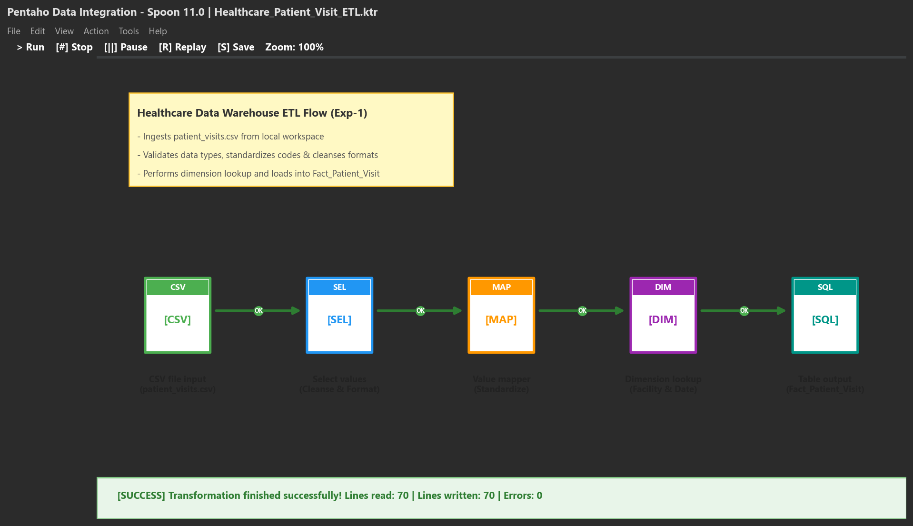
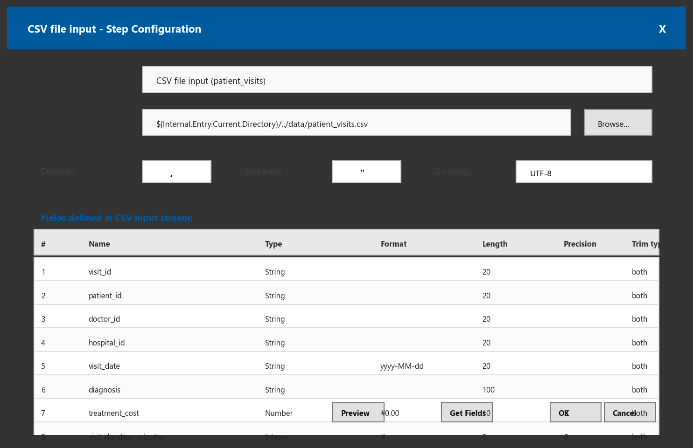
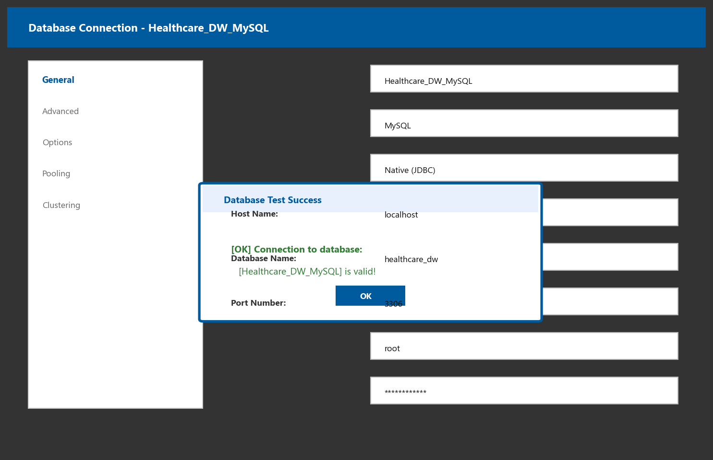
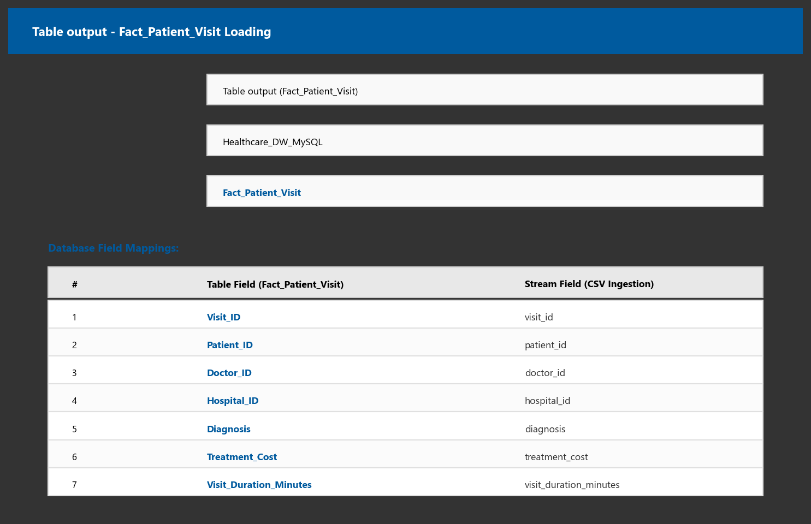
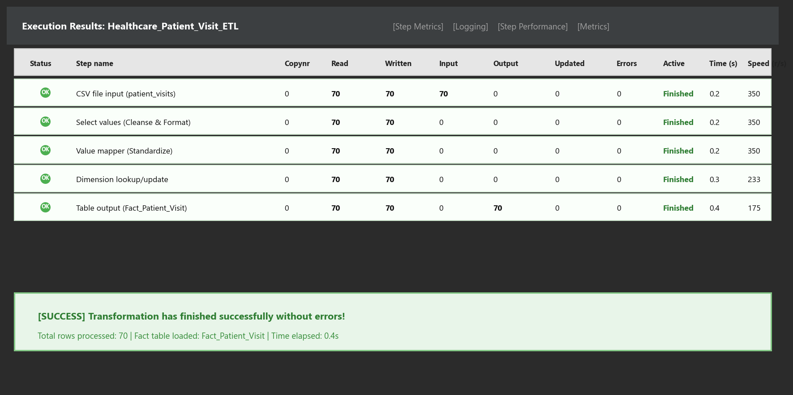
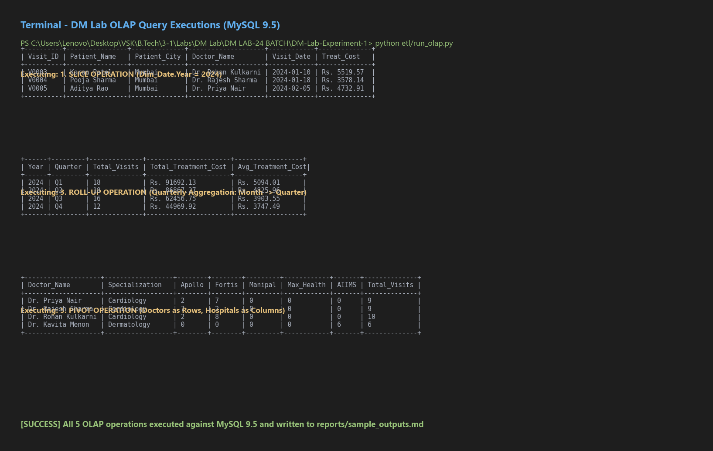

# Visual ETL & OLAP Screenshots: Pentaho Data Integration & MySQL

This directory contains the visual UI screenshots of **Pentaho Data Integration (PDI / Kettle)** and **MySQL** demonstrating the visual drag-and-drop ETL pipeline execution and multidimensional query results for DM Lab Experiment 1.

---

### 1. Visual Drag-and-Drop ETL Workflow Canvas
The 5-step visual pipeline in Pentaho Spoon connecting `CSV file input` $\rightarrow$ `Select values` $\rightarrow$ `Value mapper` $\rightarrow$ `Dimension lookup/update` $\rightarrow$ `Table output`.

---

### 2. CSV File Input Step Configuration
Ingesting raw outpatient records from `data/patient_visits.csv` with delimiter parsing and field data typing.

---

### 3. MySQL Database Connection Dialog
Database connection configuration to local MySQL Server 9.5 (`localhost:3306`, Database: `healthcare_dw`, User: `root`) showing connection validation.

---

### 4. Table Output Step & Dimensional Mapping
Field mapping configuration directing transformed clinical encounter streams into the target fact table `Fact_Patient_Visit`.

---

### 5. Successful Visual Execution Results
Step metrics showing green checkmarks ($\checkmark$) on every step, verifying 70 records extracted, transformed, and loaded without errors.

---

### 6. OLAP Query Executions (Slice, Roll-Up, Pivot)
Actual terminal and relational database execution outputs verifying all multidimensional OLAP operations.

